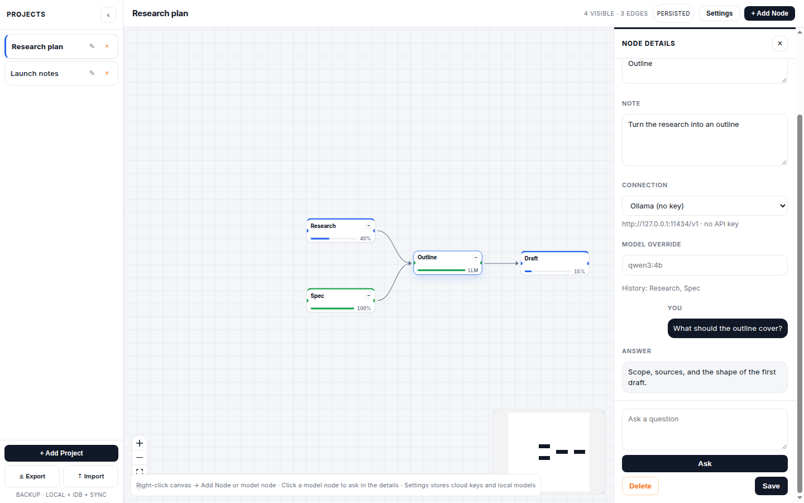

# Canvas Diagram Tool — AI Projects Manager

[中文文档](README.zh-CN.md)

A Chrome extension (MV3) for planning work on a diagram canvas. Create projects, connect task nodes, and ask a model from a node on the right. The current release is **v1.1.0**.

**[Install Canvas Diagram Tool from the Chrome Web Store](https://chromewebstore.google.com/detail/canvas-diagram-tool/hpeakcadccgijjmimdnofpkgdfaibnap)**



## Features

- **Toolbar** — Click the extension icon to open the canvas in a new tab
- **Projects** — Left sidebar to create, rename, delete, and switch projects. The first run creates `Project 1`. Drag the list wider, up to a quarter of the window
- **Canvas** — Pan, zoom, minimap, and controls. The opening view stays at a normal size so the cards remain small
- **Task nodes** — Label, note, URL, and a progress slider. An address that already starts with `http://` or `https://` is kept. A public host without a scheme gets `https://`. `localhost` and private addresses get `http://`
- **Model nodes** — Pick a saved connection, optionally override the model, and ask in the details panel. The answer stays on the node
- **Parent context** — When a model node asks, every upstream node's label, note, link, progress, and earlier answers are written into the system message. The request body itself is only `model` and `messages`
- **Settings** — Save OpenAI-compatible connections. A cloud connection needs a base URL, model, and API key. A local connection can skip the key, and no `Authorization` header is sent. Keys stay in this browser and are left out of project export
- **Edges** — Drag from the right handle to the left handle. Click an edge or press `Del` / `Backspace` to delete it
- **Collapse** — `−` / `+` on a node with children hides or shows its descendants. The header shows visible, hidden, and edge counts, and `Expand all` brings them back
- **Details panel** — Click a node to edit it on the right. Drag that panel wider, up to half the window. `Esc` closes it
- **Persistence** — Four copies of the canvas, plus JSON export and import (see below)

## Tech Stack

React 19 + TypeScript 6 + Vite 8 + `@xyflow/react` 12 + `oxlint`

## Storage — Survives "Clear Browsing Data"

`chrome.storage.local` is extension storage. A normal *Clear browsing data → Cookies and site data* does not wipe it. Each change is also written to four places, and the newest useful copy is restored on load:

| Backend | Purpose |
|---|---|
| `chrome.storage.local` | Primary copy, with `unlimitedStorage` |
| `IndexedDB` (`ai-projects-manager` / `kv`) | Second copy, with `navigator.storage.persist()` |
| `chrome.storage.sync` | Google-account copy, skipped when the payload is over 80KB |
| `localStorage` | Fallback when the page is opened outside the extension |

On load the app reads all four copies, keeps the newest, and breaks a timestamp tie by the number of nodes and edges. An empty newer copy does not replace an older copy that still has work. Missing copies are filled back in. `Export` / `Import` in the sidebar is a file backup. API keys are stored separately and are not part of that file.

Code: `src/storage/useStorage.ts`, `src/storage/idb.ts`, `src/storage/pickSnapshot.ts`, `src/storage/llmSettings.ts`

## Project Structure

```
manifest.json
background.js                 # toolbar click opens the canvas
newtab.html
vite.config.ts
src/
  main.tsx / App.tsx
  pages/CanvasPage.tsx        # canvas, menus, panels
  components/
    ProjectSidebar.tsx
    CustomNode.tsx            # task or model card, collapse toggle
    NodeEditor.tsx            # right-hand details and questions
    SettingsPanel.tsx
    PanelResizeHandle.tsx
  canvas/
    collapse.ts
    panelWidth.ts
  llm/callModel.ts            # OpenAI-compatible chat request
  storage/
    useStorage.ts
    nodeData.ts
    parentHistory.ts
    llmSettings.ts
    idb.ts
    pickSnapshot.ts
```

## Getting Started

```bash
npm install
npm run dev      # Vite dev server. Open /newtab.html
npm run build    # tsc -b && vite build  → dist/
npm run lint     # oxlint
```

## MCP

An MCP server in `mcp/` lets Cursor (or any MCP client) read and edit the same project graph the canvas uses: projects, nodes, progress, and edges.

```bash
npm run mcp:install
npm run mcp:build
```

The project config is `.cursor/mcp.json`. Reload MCP servers in Cursor after the build. The server speaks stdio and also listens on `http://127.0.0.1:47821` so the extension can sync while it is running.

Data file: `~/.local/share/ai-projects-manager/projects.json` (override with `AI_PROJECTS_DATA`).

Tools: `list_projects`, `get_project`, `describe_project`, `create_project`, `rename_project`, `delete_project`, `add_node`, `update_node`, `delete_node`, `connect_nodes`, `disconnect_nodes`. Resource: `ai-projects://graph`.

Rebuild and reload the extension after pulling this in, so the canvas page can reach the sync API. If the MCP server is not running, the canvas keeps using its existing storage.

## Load in Chrome

Install the published extension from the [Chrome Web Store](https://chromewebstore.google.com/detail/canvas-diagram-tool/hpeakcadccgijjmimdnofpkgdfaibnap).

To load a local build instead:

1. `npm run build`
2. Open `chrome://extensions` and turn on **Developer mode**
3. **Load unpacked** and choose `dist/`
4. Click the extension icon. The canvas opens in a tab

The first time a model connection is saved or called, Chrome asks for permission to reach that address.

## Usage

- **Add a task:** `+ Add Node`, or right-click the canvas → *Add Node here*
- **Add a model node:** right-click the canvas → *Add model node*, then set its type in the details
- **Edit:** click a node. Change the label, note, URL, or progress, then *Save*
- **Ask:** on a model node, choose a connection and send a question. Upstream nodes are included as context
- **Connect:** drag from the right handle to the left handle of another node
- **Delete an edge:** click it → *Delete connection*, or select it and press `Del`
- **Delete a node:** *Delete* in the details, or select it and press `Del`. Connected edges are removed
- **Collapse:** `−` on a parent node. `+` expands it. `Expand all` in the header clears every collapse
- **Resize:** drag the project list to the right, up to a quarter of the window, or drag the details to the left, up to half the window
- **Switch projects:** click a name in the sidebar
- **Backup:** `⤓ Export` downloads `ai-projects-YYYY-MM-DD.json`. `⤒ Import` restores it

### Model connections

In **Settings**, add a connection the chat endpoint can accept.

| | Base URL | Model | API key |
|---|---|---|---|
| Cloud, OpenAI-compatible | `https://api.openai.com/v1` | the model id | required |
| Google AI Studio | `https://generativelanguage.googleapis.com/v1beta/openai` | a full id, such as `gemini-3.8-flash` | required |
| Local, such as Ollama | `http://127.0.0.1:11434/v1` | the local model name | leave **Local model, no API key** checked |

The plugin posts to `{base URL}/chat/completions`. Use the provider's full model id. A short name such as `gemini` is rejected.

## Data Schema

```json
{
  "projects": [
    {
      "id": "p1",
      "name": "Project 1",
      "nodes": [
        {
          "id": "n1",
          "type": "custom",
          "position": { "x": 80, "y": 120 },
          "data": {
            "label": "Research",
            "url": "https://example.com/spec",
            "note": "Read the spec first",
            "percentage": 40
          }
        },
        {
          "id": "n2",
          "type": "custom",
          "position": { "x": 320, "y": 120 },
          "data": {
            "label": "Outline",
            "kind": "model",
            "percentage": 100,
            "profileId": "k1",
            "note": "Turn the research into an outline",
            "messages": [
              { "role": "user", "content": "What should the outline cover?" },
              { "role": "assistant", "content": "Scope, sources, and a first draft." }
            ]
          }
        }
      ],
      "edges": [{ "id": "e1", "source": "n1", "target": "n2" }]
    }
  ]
}
```

A task node omits `kind`. A model node sets `kind` to `"model"`. `model` on the node is an optional override of the connection's model.

## Permissions (MV3)

`storage`, `unlimitedStorage`

Host access for the optional MCP sync API: `http://127.0.0.1:47821/*`

Optional host access, requested when a connection is saved or called: `https://*/*` and `http://*/*`

The toolbar action opens `newtab.html`. The page is not installed as the browser's new-tab replacement.

## Build Output

`dist/` contains `newtab.html`, `background.js`, `manifest.json`, `icons/`, and `assets/`. Load that folder unpacked, or pack it as a `.crx`.

## License

MIT
